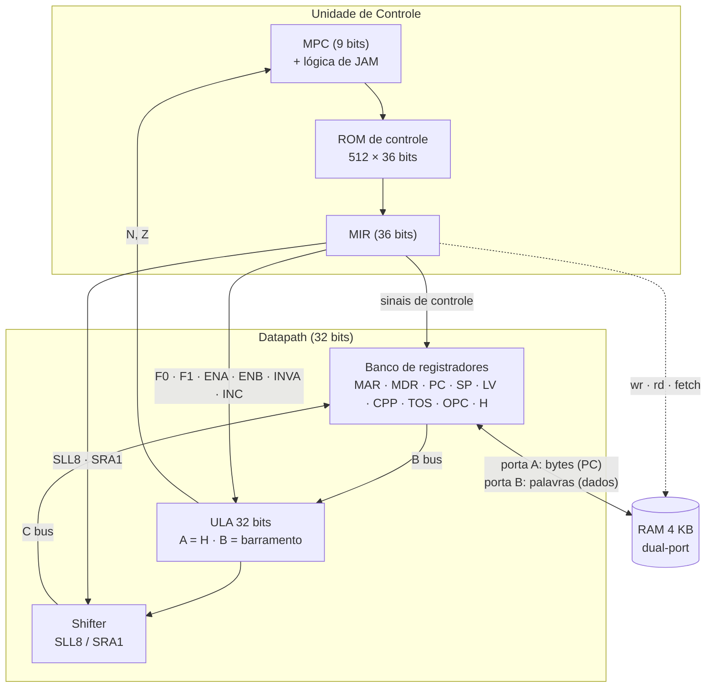

# MIC-1 — Implementação em hardware da arquitetura de Tanenbaum

**Projeto acadêmico das disciplinas Arquitetura de Computadores I (ACI) e Arquitetura de Computadores II (ACII).**

Implementação do **MIC-1**, a microarquitetura didática de 32 bits descrita por **Andrew S. Tanenbaum** em *Organização Estruturada de Computadores* (*Structured Computer Organization*), feita com **Quartus II 13.0.1**, esquemáticos (**BDF**) e **VHDL**, e validada por simulação com **vetores de onda (VWF)** e **ModelSim-Altera**.

> Este é um trabalho de faculdade. O objetivo é entender, na prática, como uma CPU funciona por dentro — do microcódigo ao programa IJVM — construindo cada bloco do zero (ULA, registradores, banco de registradores, unidade de controle microprogramada e memória) e integrando tudo em um processador funcional.

---

## Sobre o MIC-1

O MIC-1 é uma máquina de **32 bits com barramento interno único (B/C)**, cujo comportamento é definido por um **microprograma** armazenado em uma memória de controle. Cada instrução da ISA **IJVM** é executada por uma sequência de microinstruções, que controlam diretamente o datapath (registradores, ULA, shifter e memória).

O projeto implementa essa arquitetura em duas camadas:

1. **Hardware** — datapath, unidade de controle, memória e periféricos internos (esquemáticos BDF + blocos VHDL gerados pelo MegaWizard).
2. **Microcódigo e programa** — a memória de controle (`micro_code.mif`) e o programa IJVM (`RAM3.mif`, `RAM_sumen.mif`), escritos manualmente.

---

## Visão geral da implementação

- **Datapath de 32 bits** com ULA construída hierarquicamente: `ULA_1bit` → `ULA_8bit` → `ULA_32bit`, com somador completo (`FULL_ADDER_1bit/8bit`) e **shifter** (`SLL8` / `SRA1`).
- **Banco de 9 registradores** visíveis ao microcódigo: `MAR`, `MDR`, `PC`, `SP`, `LV`, `CPP`, `TOS`, `OPC` e `H`, além do **MBR** (registrador de instrução/byte).
- **Seleção de registradores** por decodificadores (`DECODER2_4`, `DECODER3_8`, `DECODER4_16`), com barramento **B** para leitura e barramento **C** para escrita.
- **Unidade de controle microprogramada**:
  - memória de controle de **512 × 36 bits** (`mc_compiler.vhd` + `micro_code.mif`);
  - registrador de microinstrução **MIR** de 36 bits;
  - **MPC** de 9 bits com lógica de **JAM** (`JMPC`, `JAMN`, `JAMZ`) e flags **N** / **Z** da ULA;
  - sinal de **write enable** de memória registrado.
- **Memória de dados/programa dual-port de 4 KB** (`RAM.vhd`):
  - **porta A**: 8 bits, endereço de 12 bits → usada para busca de instruções;
  - **porta B**: 32 bits, endereço de 10 bits → usada para dados/pilha.
- **Microcódigo e bytecode IJVM escritos à mão**, com tabelas de conferência (`micro_code.mif.txt` e `DATAPATH test microcode.txt`).
- **42 arquivos `.vwf`** de teste, cobrindo desde blocos isolados até o sistema completo executando programas IJVM.

### Diagrama simplificado



---

## Organização da memória

A RAM tem 4 KB (4096 bytes = 1024 palavras de 32 bits). O mapa é dividido em três regiões, conforme `RAM memory map.txt`:

| Região | Endereço (byte) | Endereço (palavra) | Tamanho | Uso |
|---|---|---|---|---|
| Method area | `0x000`–`0x0FF` | `0x000`–`0x03F` | 256 bytes (64 palavras) | Código IJVM (começa em `PC = 0`) |
| Frame de variáveis locais | `0x100`–`0xFBF` | `0x040`–`0x3EF` | 944 palavras (3776 bytes) | `LV` / `SP` |
| Constant pool | `0xFC0`–`0xFFF` | `0x3F0`–`0x3FF` | 16 palavras (64 bytes) | Constantes (`CPP`) |

O endereçamento de instruções é **por byte** (porta A), enquanto os dados são acessados **por palavra de 32 bits** (porta B). Essa é a mesma divisão usada pelo MIC-1 do livro.

---

## Formato da microinstrução (MIR)

Cada microinstrução tem **36 bits**. A divisão implementada no projeto é:

| Bits | Campo | Função |
|---|---|---|
| `35–27` | `NEXT_ADDRESS` | Próximo endereço de microinstrução (9 bits) |
| `26–24` | `JAM` | Seleção de salto: `JMPC` (vai para o MBR), `JAMN`, `JAMZ` |
| `23–22` | Shift | Controle do shifter: `SLL8` / `SRA1` |
| `21–16` | ALU | `F0`, `F1`, `ENA`, `ENB`, `INVA`, `INC` |
| `15–7` | C bus | Destino da escrita: `H`, `OPC`, `TOS`, `CPP`, `LV`, `SP`, `PC`, `MDR`, `MAR` |
| `6` | `wr` | Escrita na memória de dados |
| `5` | `rd` | Leitura da memória para o `MDR` |
| `4` | `fetch` | Busca da instrução para o `MBR` |
| `3–0` | B bus | Fonte para a ULA: `MDR`, `PC`, `MBR`, `MBRU`, `SP`, `LV`, `CPP`, `TOS`, `OPC` |

> `MBR` é o byte com extensão de sinal; `MBRU` é o byte sem extensão (usado, por exemplo, em índices de `ILOAD`). O registrador `H` não fica no barramento B — ele é a entrada `A` da ULA.

---

## O transpilador era eu 🧑‍💻

Não existe nenhum assembler, compilador ou transpilador automatizado neste repositório. A tradução de "código-fonte" para bits foi feita **manualmente**, e essa foi uma das partes centrais do trabalho:

- **Microcódigo:** cada microinstrução do livro foi convertida à mão para os 36 bits do MIR.
  - `micro_code.mif` → binário carregado na ROM de controle;
  - `micro_code.mif.txt` → a mesma ROM em binário "aberto", para conferir campo a campo;
  - `DATAPATH test microcode.txt` → tabela de conferência microinstrução → MIR → efeito nos registradores.

- **Programa IJVM:** as instruções (`LDC_W`, `ILOAD`, `BIPUSH`, `IADD`, `ISUB`, `IFEQ`, `INVOKEVIRTUAL`, `IRETURN`, etc.) foram montadas à mão em bytes e gravadas em `RAM3.mif` / `RAM_sumen.mif`.

Em outras palavras: o papel de **montador/transpilador** — instrução → binário — foi desempenhado manualmente, e os arquivos `.mif` / `.txt` são o "output" desse processo.

Exemplo real de microinstrução já codificada:

| Microinstrução | MIR (hex) | Comentário |
|---|---|---|
| `PC = PC + 1; fetch; goto (MBR)` | `0x004350211` | `Main1` do microcódigo |
| `PC = PC + 1` | `0x000350201` | Tabela de teste do datapath |
| `MAR = PC = PC + 1` | `0x000350281` | Tabela de teste do datapath |
| `MDR = PC = PC + 1` | `0x000350301` | Tabela de teste do datapath |

> Detalhe: `mc_compiler` é só o nome do bloco ROM gerado pelo MegaWizard — não é um compilador de microcódigo. O "compilador" foi o trabalho manual de codificação.

---

## Estrutura do repositório

```
MIC-1/
├── MC1.qpf / MC1.qsf              # Projeto Quartus II 13.0.1 (topo: MIC1)
├── MIC1.bdf                       # Topo do sistema: CPU + RAM
├── CPU.bdf                        # CPU: unidade de controle + datapath
├── CONTROL_UNIT.bdf               # MPC, JAM, ROM de microcódigo, MIR
├── mpc_generator.bdf              # Lógica do próximo MPC (JAM + N/Z)
├── DATAPATH.bdf                   # Banco de registradores + ULA + shifter
├── BANK.bdf                       # Banco de registradores (9 registradores)
├── ULA_1bit.bdf / ULA_8bit.bdf / ULA_32bit.bdf
├── FULL_ADDER_1bit.bdf / FULL_ADDER_8bit.bdf
├── SHIFTER.bdf
├── REGISTER8bit.bdf / REGISTER32bit.bdf
├── MAR.bdf, MDR.bdf, PC.bdf, SP.bdf, LV.bdf, CPP.bdf,
│   TOS.bdf, OPC.bdf, H.bdf, MBR.bdf, MBR_EXTENSOR.bdf
├── DECODER2_4.bdf, DECODER2_4EN.bdf, DECODER3_8.bdf,
│   DECODER4_16.bdf, DECODE3_8_EN.bdf
├── LV_initial_address.bdf / CPP_initial_address.bdf
├── RAM.vhd                        # RAM dual-port 4 KB (MegaWizard)
├── mc_compiler.vhd                # ROM de controle 512 × 36 bits
├── micro_code.mif                 # Microcódigo binário (MIR de 36 bits)
├── micro_code.mif.txt             # Microcódigo em binário aberto
├── RAM3.mif                       # Programa IJVM carregado no topo
├── RAM.mif / RAM_sumen.mif        # Programas IJVM alternativos
├── RAM memory map.txt             # Mapa da memória
├── DATAPATH test microcode.txt    # Tabela de conferência do datapath
├── *.vwf                          # 42 vetores de onda / testbenches
├── memory.vhd                     # RAM alternativa (não usada no topo)
├── CONTROL_UNITY.bdf              # Variante da UC (fora do projeto)
└── db/, incremental_db/, output_files/, simulation/, greybox_tmp/
                                   # Diretórios gerados pelo Quartus/ModelSim
```

---

## Como abrir, compilar e simular

1. Instale o **Quartus II 13.0.1 SP1** (a versão em que o projeto foi criado).
2. Abra o arquivo **`MC1.qpf`**.
3. Confirme o top-level **`MIC1`** em *Assignments → Settings → General*.
4. Compile com **Ctrl + L** (*Processing → Start Compilation*).
5. Para simular, abra um dos arquivos `.vwf` e execute o **University Program VWF** (ou use o **ModelSim-Altera**, já configurado no projeto).

### Trocar o programa carregado

O programa executado no topo é definido pelo `init_file` do `RAM.vhd`, atualmente **`RAM3.mif`**. Para rodar outro programa:

- substitua o conteúdo de `RAM3.mif`, **ou**
- regenere o bloco `RAM` apontando para outro `.mif` (ex.: `RAM.mif` ou `RAM_sumen.mif`).

O microcódigo é carregado por `mc_compiler.vhd` a partir de **`micro_code.mif`**.

> ⚠️ **Observação de portabilidade:** o `MC1.qsf` contém uma referência absoluta antiga (`/home/radsfer/shared/MIC1_Rafael_Adolfo/...`) em `INCREMENTAL_VECTOR_INPUT_SOURCE`. Em outra máquina, ajuste ou remova essa linha para evitar avisos do Quartus.

---

## Testes

Os `.vwf` estão organizados em níveis:

- **Blocos básicos:** `DECODER2_4`, `DECODER3_8`, `decoder4_16`, `FULL_ADDER_1bit`, `FULL_ADDER_8bit`, `ULA_1bit`, `ULA_8bit`, `ULA_32bit`, `SHIFTER`, `REGISTER8bit`, `REGISTER32bit`.
- **Registradores e periféricos:** `MAR`, `MDR`, `PC`, `MBR`, `MBR_EXTENSOR`, `SP`, `LV`, `CPP`, `TOS`, `OPC`, `H`, `BANK`.
- **Unidade de controle:** `mpc_generator`, `DATAPATH3`, `CONTROL_UNIT_bipush`, `CONTROL_UNIT_iadd_isub`, `CONTROL_UNIT_iload`, `CONTROL_UNIT_istore`.
- **CPU (instrução a instrução):** `CPU_nop`, `CPU_bipush`, `CPU_bipush_iadd`, `CPU_iload`, `CPU_istore`, `CPU_wide_iload`, `CPU_wide_istore`, `CPU_ifeq`, `CPU_iflt`, `CPU_ificmpeq`, `CPU_goto`.
- **Sistema completo:** `MIC1_iload_iadd` e `MIC1_recursive_sum` (programa IJVM recursivo).

---

## Estado atual e limitações

- ✅ Datapath, unidade de controle, memória e integração CPU + RAM funcionando em simulação.
- ✅ Microcódigo cobre as instruções IJVM usadas nos testes, incluindo `WIDE`, `INVOKEVIRTUAL` e `IRETURN`.
- ✅ Programa IJVM carregado por `.mif` e executado do início ao fim nos testes de sistema.
- ⚠️ Não há **assembler, linker ou loader** — os programas são pré-carregados nos `.mif`.
- ⚠️ Não há dispositivos de **I/O** nem sistema operacional; o foco é a microarquitetura.
- ⚠️ Projeto voltado para **simulação** (sem atribuição de pinos para uma placa específica).
- ⚠️ O conjunto IJVM implementado é **parcial** (o subconjunto necessário para os programas e testes do trabalho).

---

## Referências

- TANENBAUM, Andrew S. **Organização Estruturada de Computadores**. 5ª/6ª edição. Pearson. (Capítulo sobre o nível de microarquitetura — MIC-1 e IJVM.)
- TANENBAUM, Andrew S. **Structured Computer Organization**. 5th/6th edition. Pearson.
- Altera/Intel. **Quartus II 13.0 Handbook** e documentação do MegaWizard (ALTSYNCRAM).

---

## Autores

**Rafael e Adolfo** — projeto desenvolvido em dupla para **ACI** e **ACII**, 2024–2025.

Projeto acadêmico, sem fins comerciais.
